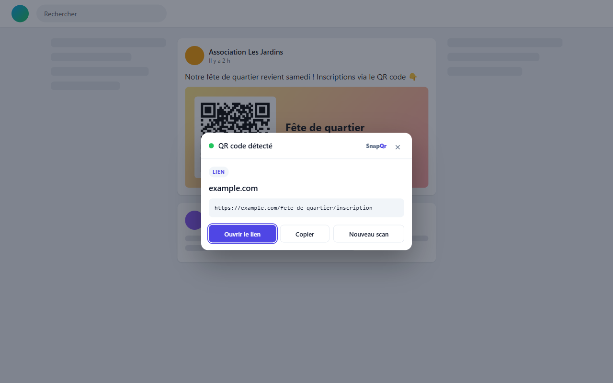
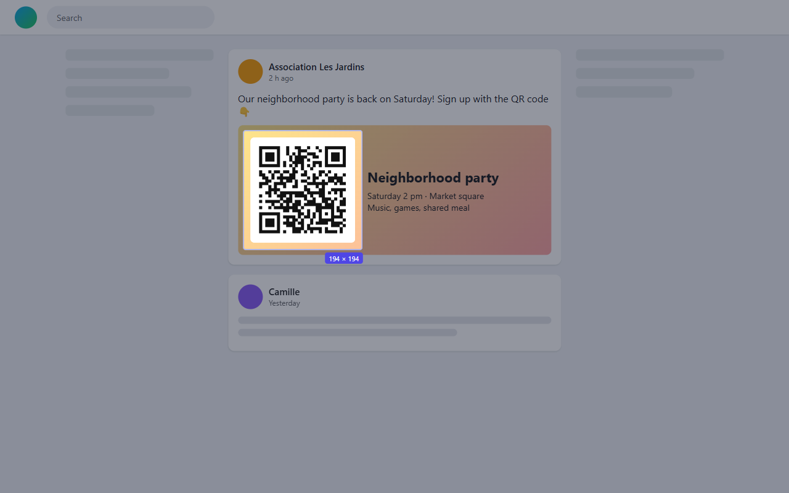

# SnapQr

Extension Edge / Chrome (Manifest V3) pour scanner les QR codes affichés sur une page web, sans téléchargement ni téléphone, et pour en générer.

> **Microsoft Edge Add-ons** : en cours de validation.

## Aperçu

| Encadrer le QR code | Importer une image | Générer un QR code |
|---|---|---|
|  |  |  |

## Installer en mode développeur

1. Ouvrir `chrome://extensions` (ou `edge://extensions`).
2. Activer le **Mode développeur**.
3. Cliquer sur **Charger l'extension non empaquetée** et choisir ce dossier.

## Utilisation

- **Scanner sur la page** : bouton « Sélectionner une zone » du popup, raccourci `Alt+Shift+S`, ou clic droit → « Scanner un QR code sur cette page ». On encadre le QR code à la souris, et le contenu s'affiche dans un modal. Un clic simple scanne toute la page visible. `Échap` pour annuler.
- **Importer une image** : dans le popup, glisser-déposer, coller (`Ctrl+V`) ou choisir un fichier.
- **Générer** : onglet « Générer », pré-rempli avec l'adresse de l'onglet. Export en PNG ou copie dans le presse-papiers.

## Structure

| Fichier | Rôle |
|---|---|
| `manifest.json` | Déclaration de l'extension et de ses permissions |
| `background.js` | Service worker : injection du calque, capture de l'onglet, décodage |
| `content/overlay.js` | Calque de sélection + modal de résultat (Shadow DOM) |
| `popup/` | Interface du bouton de la barre d'outils |
| `shared/decode.js` | Découpe + décodage avec jsQR |
| `shared/parse.js` | Détection du type de contenu (lien, Wi-Fi, e-mail, contact…) |
| `publication/` | Visuels et textes de la fiche du store (non inclus dans l'extension) |
| `lib/` | [jsQR](https://github.com/cozmo/jsQR) (Apache-2.0), [qrcode-generator](https://github.com/kazuhikoarase/qrcode-generator) (MIT) |

## Permissions

- `activeTab` : accès à l'onglet courant uniquement quand l'utilisateur clique sur l'extension, le raccourci ou le menu.
- `scripting` : injection du calque de sélection.
- `contextMenus` : entrée du clic droit.

Aucune donnée n'est envoyée sur Internet : tout est décodé localement.

## Licence

[MIT](LICENSE). Les bibliothèques du dossier `lib/` gardent leur propre licence (Apache-2.0 pour jsQR, MIT pour qrcode-generator).
