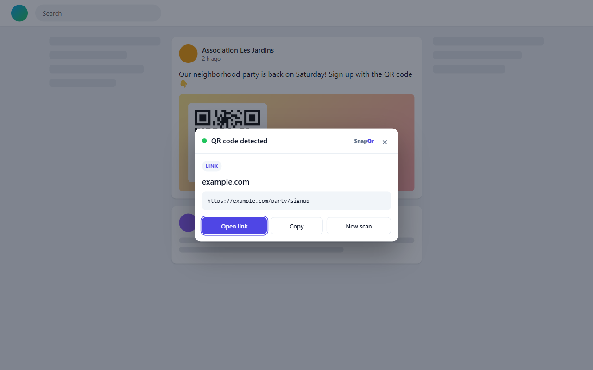
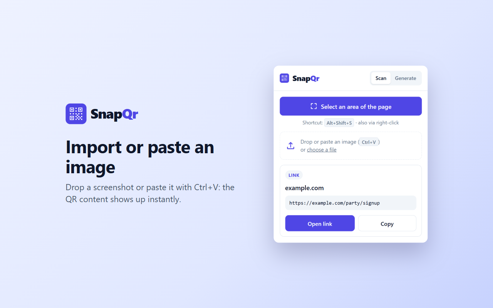
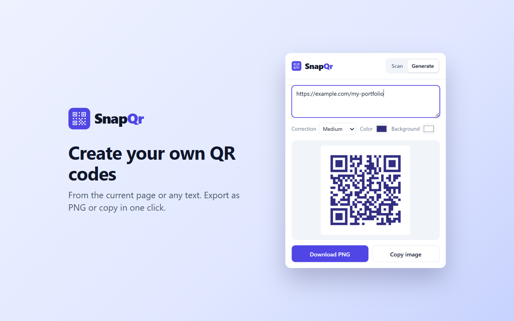

# SnapQr

Edge / Chrome extension (Manifest V3) to scan QR codes shown on any web page — no download, no phone — and to generate your own.

> **Microsoft Edge Add-ons**: under review.

## Preview

| Draw a box around the QR code | Import an image | Generate a QR code |
|---|---|---|
|  |  |  |

## Features

- **Scan from the page**: draw a box around a QR code and its content shows up in a dialog, right on the page. A single click scans the whole visible page.
- **Image import**: drop a file, pick one, or paste a screenshot with `Ctrl+V`.
- **Smart content detection**: link, Wi-Fi network (with password copy), email, phone, SMS, contact card, GPS location or plain text.
- **Safety**: the link's domain is shown prominently before opening, with a warning for insecure (`http`) links.
- **Generator**: from the current page URL or any text, with custom colors and error-correction level. Export as PNG or copy to the clipboard.
- **Quick access**: toolbar button, `Alt+Shift+S` shortcut or right-click menu.
- **Languages**: English and French, picked automatically from the browser language.
- **Private**: everything is decoded locally, nothing is sent over the internet.

## Install in developer mode

1. Open `edge://extensions` (or `chrome://extensions`).
2. Turn on **Developer mode**.
3. Click **Load unpacked** and select this folder.

## Project structure

| File | Role |
|---|---|
| `manifest.json` | Extension declaration and permissions |
| `background.js` | Service worker: injects the overlay, captures the tab, decodes |
| `content/overlay.js` | Selection overlay + result dialog, isolated in a Shadow DOM |
| `popup/` | Toolbar popup (scan / generate tabs) |
| `shared/decode.js` | Cropping + decoding with jsQR |
| `shared/parse.js` | Content type detection (link, Wi-Fi, email, contact…) |
| `shared/i18n.js` | Translation helper |
| `_locales/` | UI strings in English (`en`, default) and French (`fr`) |
| `docs/` | Screenshots used in this README |
| `lib/` | [jsQR](https://github.com/cozmo/jsQR) (Apache-2.0), [qrcode-generator](https://github.com/kazuhikoarase/qrcode-generator) (MIT) |

## How a page scan works

1. The popup (or the shortcut / context menu) asks the service worker to inject `content/overlay.js` into the active tab.
2. The user draws a box; the overlay hides itself and sends the box coordinates to the service worker.
3. The service worker captures the visible tab, converts CSS pixels to device pixels, crops the box and decodes it with jsQR.
4. The overlay shows the decoded content in a dialog.

## Permissions

- `activeTab`: access to the current tab only when the user clicks the extension, presses the shortcut or uses the context menu.
- `scripting`: injects the selection overlay.
- `contextMenus`: the right-click entry.

No data is sent over the internet: everything is decoded locally.

## License

[MIT](LICENSE). The libraries in `lib/` keep their own licenses (Apache-2.0 for jsQR, MIT for qrcode-generator).
